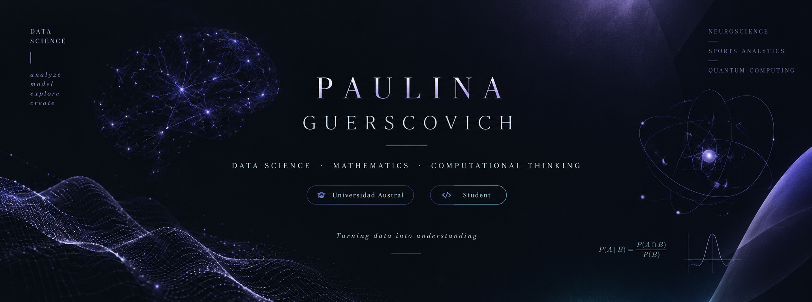

  

---

### `01` — About me

I'm **Paulina**, a Data Science student at **Universidad Austral**, Argentina.

Currently building my foundations in programming, mathematics and statistical thinking, while exploring how data can help us understand complex systems and uncover meaningful patterns.

I'm particularly interested in the intersection of **data science, neuroscience, sports analytics and quantum computing**.

I believe some of the most interesting questions emerge where different disciplines meet.

---

### `02` — Currently exploring

<table>
<tr>
<td width="50%" valign="top">

**⌘ Programming & Data**

- Python
- R / RStudio
- Data manipulation
- Data mining models
- Exploratory data analysis

</td>
<td width="50%" valign="top">

**∑ Mathematical foundations**

- Statistics & probability
- Discrete mathematics
- Mathematical logic
- Algorithms & computational thinking
- Mathematical modeling

</td>
</tr>
</table>

---

### `03` — Areas of curiosity

| FIELD | WHAT INTERESTS ME |
|:---|:---|
| 🧠 **Neuroscience** | Understanding the brain, cognition and human behavior |
| ⚔️ **Sports Analytics** | Performance, strategy and statistical insights in sports |
| ◈ **Quantum Computing** | New computational paradigms and their possibilities |
| ⌘ **Data Science** | Finding patterns, building models and extracting knowledge |

---

### `04` — Tech stack & tools

**Currently learning**

 

  

**Academic foundations**

 

---

### `05` — GitHub activity

---

### Always learning. Always questioning.

*Somewhere between mathematics, code and curiosity.*

 

© Paulina Guerscovich · 2026

